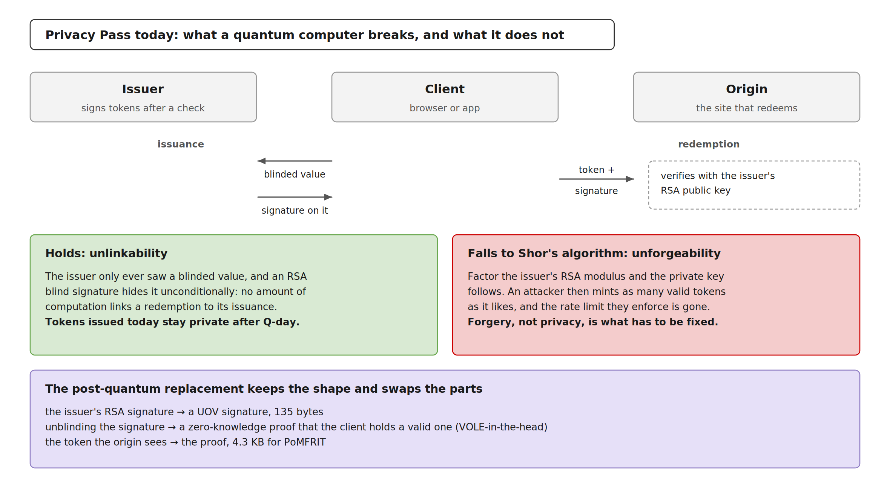
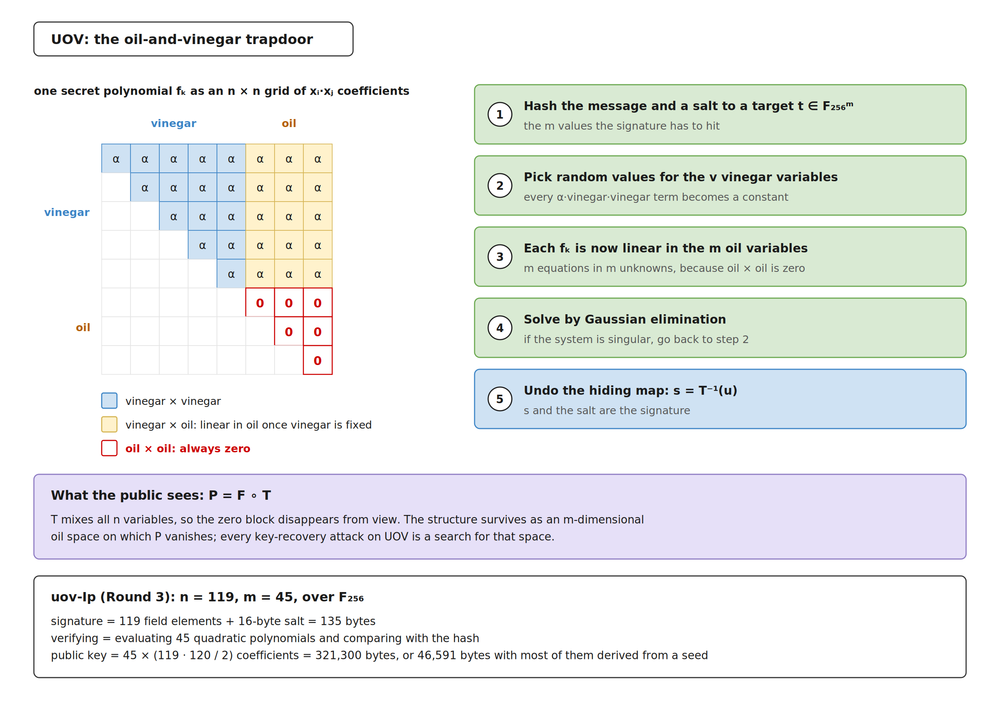
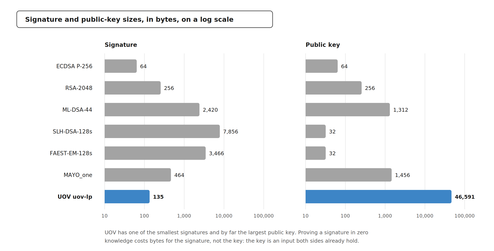
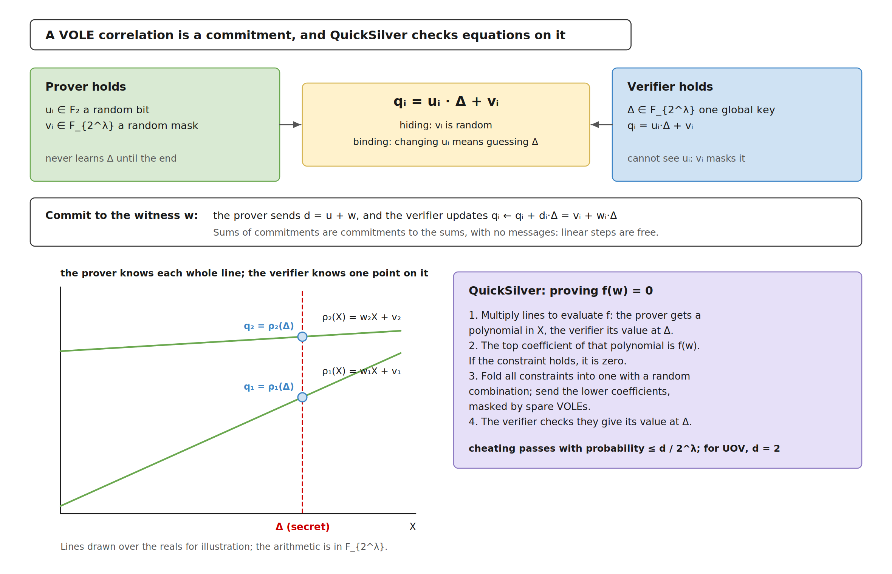
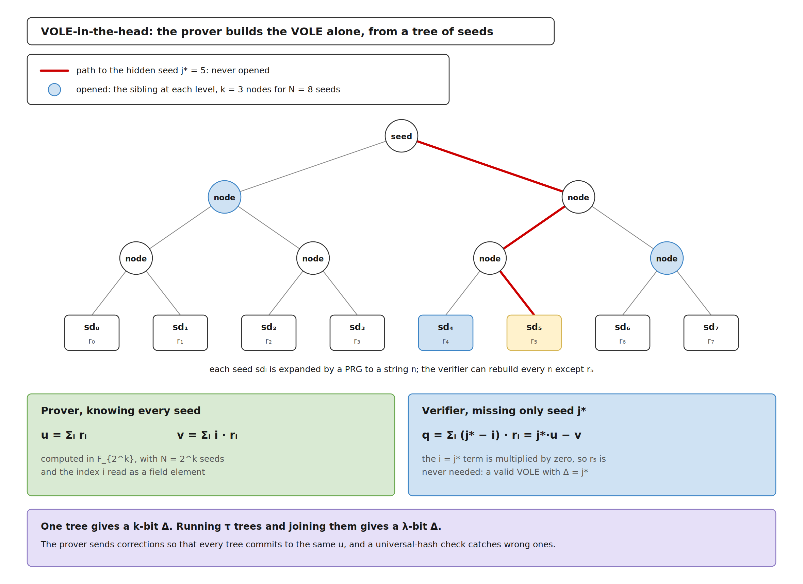
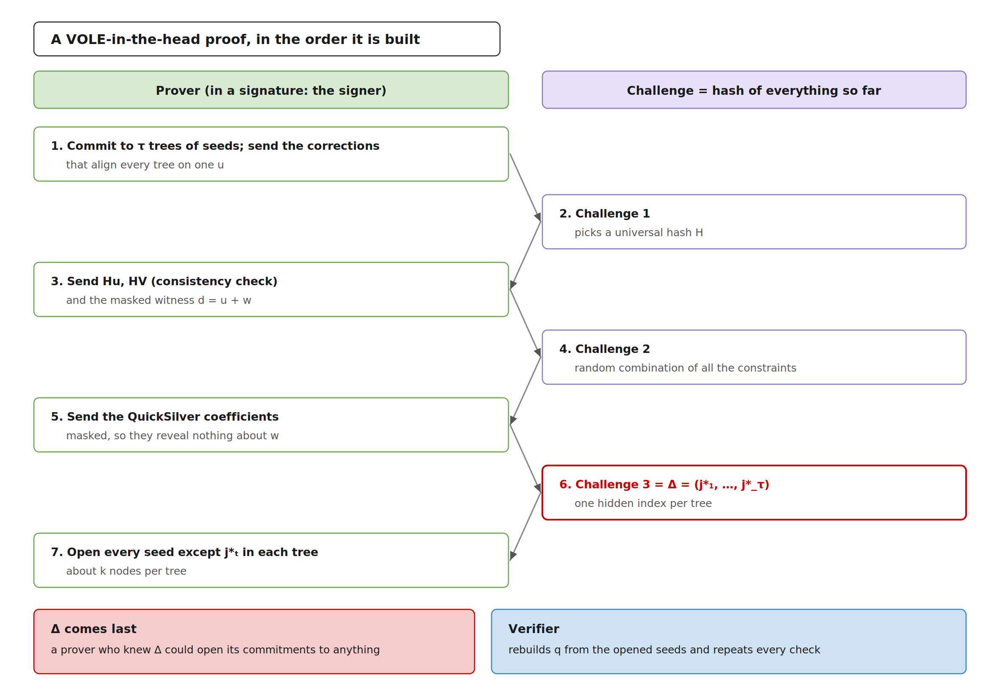
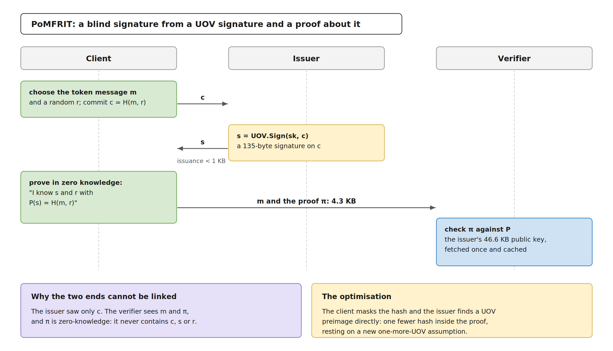
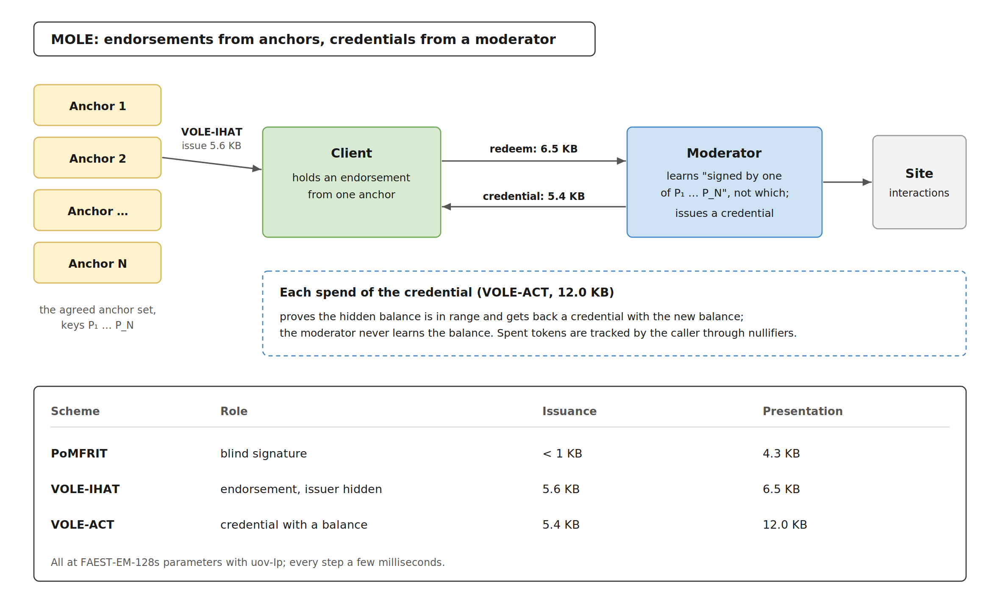

# Post-quantum Privacy Pass: anonymous credentials from UOV and VOLE-in-the-head

> Privacy Pass lets a site rate-limit or vouch for a client without learning who it
> is: an issuer hands out tokens, and a token's redemption cannot be linked to its
> issuance. Today's tokens rest on RSA blind signatures and elliptic curves. On
> 6 November 2026 Cloudflare Research published three post-quantum replacements built
> from the UOV multivariate signature and the VOLE-in-the-head proof system behind
> FAEST, with an implementation. This note reads the post and the code.
> Post: <https://blog.cloudflare.com/vole-mole/> (Bas Westerbaan).
> Code: <https://github.com/cloudflareresearch/vole-mole>.
>
> Checked 8 November 2026 against the post, the repository README, the papers it
> cites, and the UOV Round 3 and FAEST v2 specifications.

## The short version

1. **A quantum computer breaks forgery, not privacy.** Privacy Pass is
   unconditionally private: once Q-day arrives, already-issued tokens stay unlinkable.
   What falls is the issuer's signature, so an attacker could mint tokens and walk
   past the rate limits they enforce.
2. **The building blocks are UOV and VOLE-in-the-head.** UOV is a multivariate
   signature: 135-byte signatures, 46.6 KB public keys, and verification that is just
   45 quadratic equations. VOLE-in-the-head, the proof system behind FAEST, proves
   degree-2 equations over binary fields cheaply, with proofs that grow with the
   witness. A UOV signature is a 952-bit witness for 45 such equations, so proving one
   is cheap. All estimates use FAEST-EM-128s parameters.
3. **Three constructions cover the Privacy Pass family.**

   | Scheme | What it is | Issuance | Presentation |
   | --- | --- | ---: | ---: |
   | PoMFRIT (with UOV) | blind signature | < 1 KB | 4.3 KB |
   | VOLE-IHAT | token that also hides which issuer signed it | 5.6 KB | 6.5 KB |
   | VOLE-ACT | anonymous credit token with a hidden balance | 5.4 KB | 12.0 KB |

4. **The cost is in line with the rest of the migration.** The authors put the
   overhead of replacing RSA blind signatures with PoMFRIT on a par with replacing
   ECDSA with ML-DSA, and every operation runs in milliseconds.
5. **It is research code.** The repository describes itself as experimental and
   unaudited, with APIs and wire formats expected to change, and one of the
   optimisations rests on a new assumption, one-more-UOV.

## 1. What Privacy Pass protects

An issuer signs a token for a client after some check, such as a challenge or an
attestation. Later the client presents the token to a site, which verifies the
signature. Two properties matter:

- **Unlinkability.** The issuer cannot tell which issuance a redemption came from.
  RSA blind signatures give this unconditionally, so it holds against any attacker,
  quantum or not.
- **Unforgeability.** Only the issuer can make tokens. This rests on RSA, and Shor's
  algorithm breaks it.

[](https://raw.githubusercontent.com/AppliedPQC/pqc-research/main/figures/privacy-pass-post-quantum/privacy-pass.png)

The post also cites a recent classical result: researchers at UC San Diego and Inria
forged a 1024-bit RSA signature by using a Privacy Pass issuer as a signing oracle
(ePrint 2026/2131). Privacy Pass deployments use 2048-bit RSA, which the authors
consider a comfortable margin with the other defences in place.

The tokens also reveal their issuer, because verification needs the issuer's public
key. Hiding that is what VOLE-IHAT adds.

## 2. UOV, the signature

### The hard problem

UOV belongs to multivariate public-key cryptography. Its public key is a map
`P: F_q^n → F_q^m` made of `m` quadratic polynomials in `n` variables,

```
p_k(x_1, …, x_n) = Σ_{i ≤ j} a^(k)_{i,j} · x_i · x_j + Σ_i b^(k)_i · x_i + c^(k),   k = 1 … m
```

Evaluating `P` takes only multiplications and additions. Inverting it, which means finding some
`x` with `P(x) = t`, is the **MQ problem**. MQ is NP-complete over every finite field,
and its hardest instances have `m` and `n` of the same order. Factoring and discrete
logarithms play no part, which is why Shor's algorithm has nothing to attack.

### The trapdoor: oil and vinegar

The signer knows a hidden structure that makes one particular `P` easy to invert. The
variables are split into `v = n − m` *vinegar* variables and `m` *oil* variables, and
each secret polynomial `f_k` is built with no oil-times-oil terms:

```
f_k(x) = Σ_{i ≤ v, j ≥ i} α^(k)_{i,j} · x_i · x_j
```

Fix the vinegar variables to random values and every `f_k` becomes *linear* in the
oil variables. Inverting `F = (f_1, …, f_m)` then means solving `m` linear equations
in `m` unknowns by Gaussian elimination. If the system happens to be singular, the
signer draws new vinegar values. A random invertible linear map `T` hides the
structure, and the public key is `P = F ∘ T`. In geometric terms, the secret is an
`m`-dimensional *oil space* on which `P` vanishes, and every attack on UOV is an
attempt to find it.

**Signing.** Hash the message with a fresh 16-byte salt to a target `t ∈ F_q^m`,
invert `F` as above to get `u`, and output `s = T^(-1)(u)` with the salt.
**Verifying.** Check `P(s) = Hash(message ‖ salt)`: evaluate `m` quadratic polynomials
and compare.

[](https://raw.githubusercontent.com/AppliedPQC/pqc-research/main/figures/privacy-pass-post-quantum/uov-trapdoor.png)

That shape explains UOV's sizes. The signature is just `n` field elements plus the
salt, and the public key is every coefficient of `P`. For uov-Ip, that is
45 × (119 × 120 / 2) = 321,300 bytes. The compressed variant, used here, derives most of the coefficients from a seed and stores the rest: 46,591
bytes.

| Round-3 parameter set | NIST level | (n, m, q) | Compressed public key | Signature |
| --- | :---: | --- | ---: | ---: |
| uov-Ip | 1 | (119, 45, 256) | 46,591 B | 135 B |
| uov-Is | 1 | (160, 64, 16) | 66,576 B | 96 B |
| uov-III | 3 | (193, 72, 256) | 189,232 B | 209 B |
| uov-V | 5 | (259, 96, 256) | 446,992 B | 275 B |

The Privacy Pass work uses uov-Ip, which is where its 135-byte signatures and 46.6 KB
keys come from.

### Three decades of cryptanalysis

- **1997.** Patarin proposes Oil and Vinegar with as many vinegar as oil variables.
- **1998.** Kipnis and Shamir break that balanced version with an invariant-subspace
  attack that recovers the oil space.
- **1999.** Kipnis, Patarin and Goubin publish *Unbalanced* Oil and Vinegar, with
  `n > 2m`, which puts the oil space out of that attack's reach.
- **2022.** Beullens breaks Rainbow, a layered UOV variant and NIST round-3 finalist,
  in "a weekend on a laptop". The attack used Rainbow's extra layers, and plain UOV
  went on into NIST's additional-signatures process.
- **2025–2026.** The wedge attack (Ran; generalised by Jin et al. and by Furue and
  Ikematsu) gives a new way to search for the oil space. UOV's Round 3 specification
  (30 August 2026) raised its parameters in response, moving uov-Ip to `n = 119`,
  `m = 45`.

The Round 3 specification puts the cheapest known attack on uov-Ip, the wedge attack,
at 2^144 bit operations, and the direct algebraic attack at 2^146.

### Relatives

UOV's weakness is the size of its public key, and its relatives trade structure for
smaller keys.
- **MAYO** (Beullens) uses an oil space too small to sign with directly and "whips" it
  into a larger map: MAYO_one has a 1,456-byte public key and 464-byte signatures.
- **QR-UOV** and **SNOVA** compress the key with algebraic structure.

UOV, MAYO, QR-UOV and SNOVA are all in the third round of NIST's additional
signatures ([NIST IR 8610](https://csrc.nist.gov/pubs/ir/8610/final), May 2026).

[](https://raw.githubusercontent.com/AppliedPQC/pqc-research/main/figures/privacy-pass-post-quantum/sizes.png)

## 3. VOLE-in-the-head, the proof system

### VOLE as a commitment

A *VOLE correlation* gives the prover random bits `u_i ∈ F_2` and field elements
`v_i ∈ F_{2^λ}`, and gives the verifier a global key `Δ ∈ F_{2^λ}` and values

```
q_i = u_i · Δ + v_i
```

This works as a commitment to the bits `u_i`:
- **Hiding.** The random `v_i` hides `u_i` inside `q_i`.
- **Binding.** Opening to a different bit would require the prover to guess `Δ`,
  which succeeds with probability `2^(-λ)`.
- **Linearly homomorphic.** Sums of commitments are commitments to the sums, so the
  verifier can add committed values without any interaction.

To commit to a witness `w`, the prover sends `d = u + w`. The verifier updates its
values to `q_i + d_i · Δ = v_i + w_i · Δ`, which is now a commitment to `w_i`.

### Proving constraints: QuickSilver

QuickSilver (Yang, Sarkar, Weng and Wang, CCS 2021) proves that committed values
satisfy polynomial constraints.

1. **Each value is a line.** The prover sees each committed value as a degree-1
   polynomial `ρ_i(X) = w_i · X + v_i`. The verifier holds its value at the secret
   point, `q_i = ρ_i(Δ)`.
2. **Products are polynomial products.** Multiplying two commitments multiplies the
   polynomials. The prover gets a degree-2 polynomial and the verifier the matching
   point `q_i · q_j`.
3. **A satisfied constraint loses its top coefficient.** Evaluate a constraint
   `f(w) = 0` of degree `d` this way. The top coefficient of the prover's polynomial
   is `f(w)` itself, so if the constraint holds it is zero.
4. **One check for all constraints.** Every constraint is folded into one with a random
   linear combination. The prover sends the remaining coefficients, masked with spare
   random VOLEs so that they reveal nothing. The verifier checks that they evaluate at
   `Δ` to what it computed itself.

A prover who cheats passes only if `Δ` is a root of a nonzero degree-`d` polynomial,
which has probability at most `d / 2^λ`. For UOV, `d = 2`.

[](https://raw.githubusercontent.com/AppliedPQC/pqc-research/main/figures/privacy-pass-post-quantum/vole-quicksilver.png)

### Putting the verifier in the head

A VOLE correlation normally needs an interactive protocol with the verifier.
VOLE-in-the-head (Baum, Braun, Delpech de Saint Guilhem, Klooß, Orsini, Roy and
Scholl, Crypto 2023) lets the prover make one alone, then reveal just enough later
for anyone to check.

1. **Commit to seeds.** The prover commits to `N = 2^k` seeds with an *all-but-one*
   vector commitment, a GGM tree of length-doubling PRGs, and expands each seed to a
   string `r_i`.
2. **Build the prover's side.** In `F_{2^k}` it sets
   ```
   u = Σ r_i            v = Σ i · r_i
   ```
3. **Prove first, then learn the challenge.** It sends the masked witness and the
   QuickSilver response. Only then is the challenge `Δ = j*` drawn.
4. **Open all but one.** The prover opens every seed except seed `j*`, which takes
   about `k` tree nodes. The verifier computes
   ```
   q = Σ (j* − i) · r_i = j* · u − v
   ```
   which is a valid VOLE without the missing seed, because the term for `i = j*`
   vanishes.

[](https://raw.githubusercontent.com/AppliedPQC/pqc-research/main/figures/privacy-pass-post-quantum/voleith-tree.png)

The order is essential: once the prover knows `Δ`, binding is gone. With Fiat–Shamir,
every challenge is a hash of the transcript so far, and the proof becomes a
non-interactive, publicly verifiable signature.

[](https://raw.githubusercontent.com/AppliedPQC/pqc-research/main/figures/privacy-pass-post-quantum/voleith-flow.png)

A single tree gives `Δ` only `k` bits. VOLE-in-the-head therefore runs `τ` trees and
joins them into one `λ`-bit key.
- **Aligning the trees.** The prover sends corrections that make every tree commit to
  the same `u`.
- **Checking the corrections.** A universal-hash consistency check, from Roy's
  SoftSpokenOT, catches a prover who sends wrong ones.

### What a proof costs

A proof contains:
- the masked witness;
- `τ − 1` correction vectors of the same length;
- the consistency-check and QuickSilver values;
- for each tree, the opened path and the commitment to the hidden seed.

Its size therefore grows linearly with the witness, and the number of constraints
barely matters.

The parameter that trades size against speed is `N`. A larger `N` needs fewer trees,
which gives a shorter proof, but the prover and verifier expand about `τ · N` seeds,
which makes it slower. FAEST names the two ends "s", slow and short, and "f", fast
and long.

### Compared with MPC-in-the-head

Both techniques begin by splitting the witness into `N` shares and hiding one.
- **MPC-in-the-head** (Ishai, Kushilevitz, Ostrovsky and Sahai, 2007) simulates a
  multi-party computation and opens all but one party's view. It is the basis of
  Picnic and of the round-3 candidate SDitH.
- **VOLE-in-the-head** replaces the multi-party computation with a two-party,
  VOLE-based proof, closer to oblivious-transfer extension.

Its authors report proofs that are linear in size and simpler, smaller and faster
than MPC-in-the-head. The communication is about twice that of the best VOLE proofs
that only a designated verifier can check.

### FAEST, the signature built on it

A FAEST key pair is a plaintext–ciphertext pair `pk = (x, y)` with secret key `k`
such that `AES_k(x) = y`. A signature is a VOLE-in-the-head proof of knowledge of
`k`, with the message bound into the Fiat–Shamir challenges.
- **Witness.** The prover records bits around each AES S-box and proves them
  consistent with low-degree constraints. FAEST v2 uses degree-3 constraints.
- **FAEST-EM.** This variant uses the Even–Mansour form `y = AES_x(k) ⊕ k`, with `x`
  public, so there is no key schedule to prove.
- **Assumptions.** Apart from AES, FAEST's security rests only on PRGs and hash
  functions, because QuickSilver is information-theoretically secure. FAEST is also
  in NIST's third round.

| Parameter set | Public key | Signature |
| --- | ---: | ---: |
| FAEST-128s | 32 B | 4,066 B |
| FAEST-128f | 32 B | 5,170 B |
| FAEST-EM-128s | 32 B | 3,466 B |
| FAEST-EM-128f | 32 B | 4,170 B |

The same machinery proves other one-way functions. KuMQuat (Baum, Beullens, Mukherjee,
Orsini, Ramacher, Rechberger, Roy and Scholl, ePrint 2024/490) proves knowledge of a
solution to an MQ system, and the Privacy Pass work proves knowledge of a UOV
signature.

## 4. Why they fit together

To prove "I hold a valid UOV signature `s` on `t`", the prover commits to `s` and
shows `P(s) = t`.

| | UOV signature (uov-Ip) | ML-DSA-44 signature |
| --- | --- | --- |
| What the proof checks | 45 quadratic equations in `s`: `P(s) = t` | NTTs, SHAKE, rounding and norm bounds |
| Constraint degree | 2, which QuickSilver checks directly | mixed; the arithmetic is decomposed gate by gate |
| Witness | `s` alone: 119 elements of `F_256`, 952 bits | every intermediate value |
| Field | `F_256`, inside `F_{2^λ}` as FAEST already uses it | the ML-DSA prime field, which is not binary |

The witness drives the proof size, and for UOV it is small. The 46.6 KB public key is
an input that both sides already hold, so it costs computation but no proof bytes,
and an issuer's key is fetched once and used for many tokens.

What remains expensive is hashing inside the proof. In PoMFRIT the client proves
`P(s) = H(m, r)` with `r` secret, so `H` has to be evaluated in zero knowledge. That
is why removing one hash, at the price of the one-more-UOV assumption, is the
optimisation that matters.

## 5. The three constructions

**PoMFRIT** (Baum et al., USENIX Security 2026, ePrint 2026/109) turns a signature
into a blind signature:

1. The client commits to its message, `c = H(m, r)`.
2. The issuer signs the commitment, `s = Sign(sk, c)`.
3. The client proves in zero knowledge that it knows `s` and `r` such that
   `Verify(pk, H(m, r)) = 1`. That proof is the blind signature.

The issuer saw only `c`, and the verifier sees only a proof, so the two cannot be
linked. The paper uses MAYO, for a 6.7 KB signature; with UOV it is 4.3 KB, and
issuance stays under 1 KB. A further optimisation has the client mask the hash and
the issuer find a UOV preimage directly, removing one hash from the proof; it changes
the security assumption to *one-more-UOV*.

[](https://raw.githubusercontent.com/AppliedPQC/pqc-research/main/figures/privacy-pass-post-quantum/pomfrit.png)

**MOLE** (Moderation Of unLinkable Endorsements) is the protocol shape the other two
schemes target, which the post links to Mozilla Hacks. An *anchor* issues an
*endorsement*; a *moderator* accepts its redemption, where the client proves it holds
an endorsement from one key in the agreed anchor set without saying which; the
moderator then issues a *credential* that governs the client's interaction with the
site. Credentials need not hide their issuer or be publicly verifiable.

- **VOLE-IHAT** is the endorsement candidate: an issuer-hiding token whose redemption
  proves a valid signature under one of the anchor keys `P₁, …, P_N`, with the index
  kept in the witness. 5.6 KB to issue, 6.5 KB to redeem.
- **VOLE-ACT** is the credential candidate: an anonymous credit token whose balance
  the issuer updates on each spend without learning it. Proving that a balance lies
  in a range is cheap in VOLE-in-the-head. 5.4 KB to issue, 12.0 KB to spend.

[](https://raw.githubusercontent.com/AppliedPQC/pqc-research/main/figures/privacy-pass-post-quantum/mole.png)

## 6. The code

[`cloudflareresearch/vole-mole`](https://github.com/cloudflareresearch/vole-mole) is a
C++ library built with Meson, under the BSD 3-Clause licence. It implements PoMFRIT,
VOLE-IHAT (bound and unbound) and VOLE-ACT, with examples for each, and bundles
`faest-arch-opt` (MIT) and `pqov` (CC0 or Apache-2.0).

- **Build.** Meson 1.4+, Ninja, Python 3 and Clang 21+ or GCC 16+.
- **Performance**, on an Apple M4 Pro by the README: client messages with proofs of
  5–17 KB, or 4–12 KB with the smaller-proof parameter option; every step under 2 ms
  except VOLE-IHAT redemption, about 7 ms with 64 anchors.
- **Status.** "Experimental and not audited. Do not use in production." Double-spend
  checks belong to the caller, who tracks nullifiers.

## 7. The work the authors set out

The post closes by calling post-quantum anonymous credentials a move "from
cryptography design to protocol engineering", and lists what comes next:

- security proofs that reduce each protocol to the security of UOV;
- more cryptanalysis of multivariate schemes, which may change parameters and costs,
  with NIST Level 3 parameters for UOV suggested as a hedge for the one-more-UOV
  optimisation;
- amortisation, so one redemption covers several requests.

## What it means in practice

- **Operators of Privacy Pass issuers.** Today's tokens stay private after Q-day;
  forgery is the exposure, and it matters only once a quantum computer exists, since
  tokens are short-lived. That puts this migration on the signature clock, not the
  harvest-now-decrypt-later clock that drove key exchange.
- **Protocol designers.** A 4–12 KB token is workable on the web. Size, not compute,
  is the cost to plan for, and caching the 46.6 KB issuer key is part of the design.
- **Implementers.** Use `vole-mole` to measure and to experiment. The authors list
  security proofs and stable parameters as the next step.

## Sources

- Bas Westerbaan, [The post-quantum future of web privacy](https://blog.cloudflare.com/vole-mole/), Cloudflare, 6 November 2026.
- [`cloudflareresearch/vole-mole`](https://github.com/cloudflareresearch/vole-mole), README.
- Baum et al., [Publicly verifiable zero-knowledge and post-quantum signatures from VOLE-in-the-head](https://eprint.iacr.org/2023/996), Crypto 2023.
- Baum et al., [Concretely efficient blind signatures based on VOLE-in-the-head proofs and the MAYO trapdoor](https://eprint.iacr.org/2026/109) (PoMFRIT), USENIX Security 2026.
- [Forging 1024-bit RSA signatures in nearly SNFS time](https://eprint.iacr.org/2026/2131), ePrint 2026/2131.
- Beullens, Chen, Ding, Gong, Kannwischer, Patarin, Peng, Schmidt, Shih, Tao and Yang, [UOV: Unbalanced Oil and Vinegar, Algorithm Specifications, Version 3.0](https://csrc.nist.gov/csrc/media/Projects/pqc-dig-sig/documents/UOV_Specification_R3.pdf), 30 August 2026.
- The FAEST team, [FAEST v2: Algorithm Specifications, Version 2.0](https://csrc.nist.gov/csrc/media/Projects/pqc-dig-sig/documents/round-2/spec-files/faest-spec-round2-web.pdf), and the [current parameter sets](https://faest.info/).
- Yang, Sarkar, Weng and Wang, [QuickSilver: efficient and affordable zero-knowledge proofs for circuits and polynomials over any field](https://eprint.iacr.org/2021/076), CCS 2021.
- Beullens, [Breaking Rainbow takes a weekend on a laptop](https://eprint.iacr.org/2022/214), Crypto 2022.
- Baum, Beullens, Mukherjee, Orsini, Ramacher, Rechberger, Roy and Scholl, [One tree to rule them all: optimizing GGM trees and OWFs for post-quantum signatures](https://eprint.iacr.org/2024/490) (KuMQuat).
- [MAYO parameters](https://pqmayo.org/params-times/); [NIST IR 8610](https://csrc.nist.gov/pubs/ir/8610/final), the third round of additional signatures.
- IETF [Privacy Pass working group](https://datatracker.ietf.org/wg/privacypass/about/).
